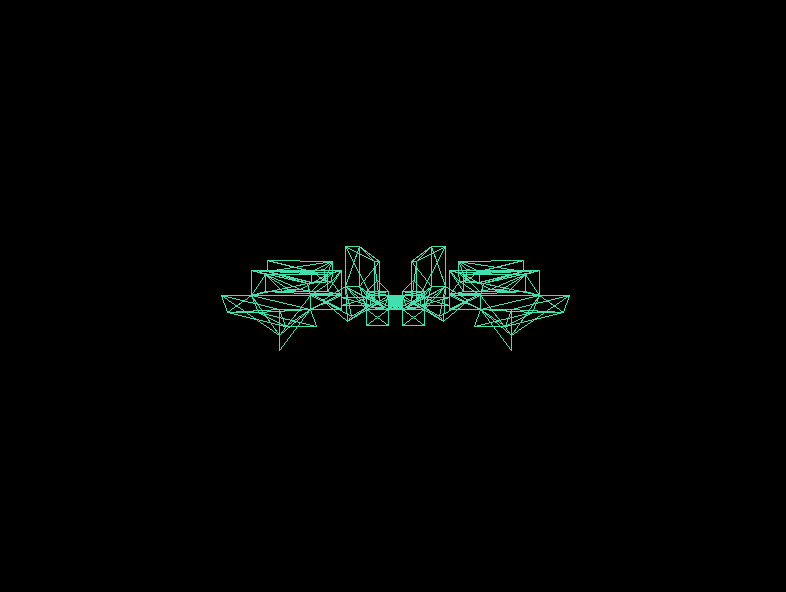
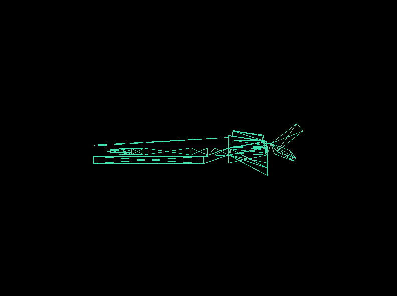
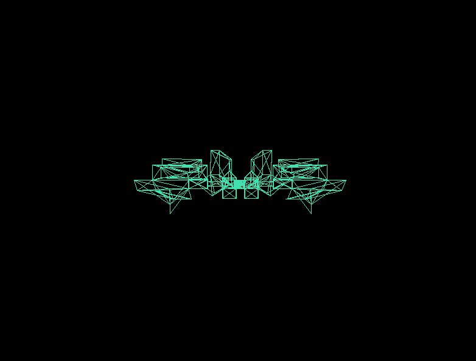
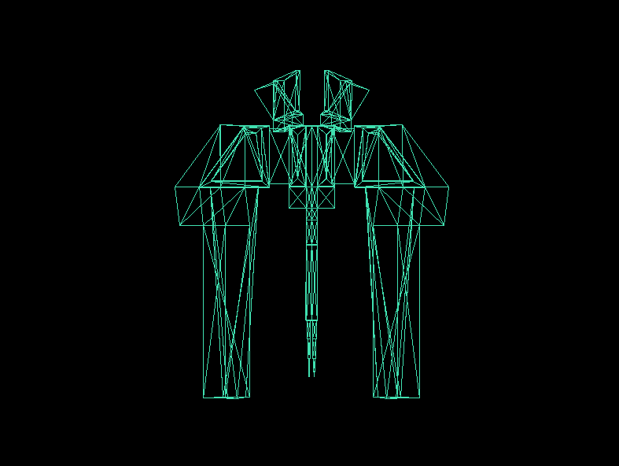
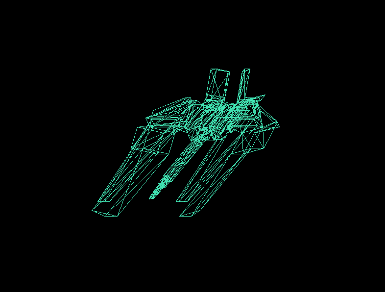

# Laboratorio 4  - Carga de modelos

### Gráficas por Computadora
### José Sanchez - 24092
---

Renderer escrito en Rust con Raylib. El programa carga el modelo
triangulado de un archivo obj, obtiene sus vértices e índices y dibuja el
contorno de cada triángulo mediante algoritmos propios de punto, línea y
triángulo.

Raylib se utiliza para crear la ventana y colocar píxeles en pantalla, pero no
para cargar ni dibujar automáticamente el modelo 3D.

## Ejecución

Es necesario tener instalado Rust. Para compilar y ejecutar el proyecto:

```bash
cargo run
```

## Controles

- `A` o `←`: rotar hacia la izquierda.
- `D` o `→`: rotar hacia la derecha.
- `W` o `↑`: rotar hacia arriba.
- `S` o `↓`: rotar hacia abajo.
- Arrastrar con el botón izquierdo del mouse: rotar libremente en ambos ejes.
- `Esc`: cerrar la ventana.

## Organización

- `obj.rs`: carga los vértices e índices del archivo OBJ.
- `line.rs`: dibuja puntos, líneas y triángulos.
- `screen.rs`: centra, escala, rota y proyecta los vértices.
- `controls.rs`: procesa el teclado y el mouse.
- `renderer.rs`: recorre y dibuja los triángulos del modelo.
- `main.rs`: inicializa la ventana y ejecuta el ciclo de renderizado.

## Resultado

| Vista frontal | Vista lateral |
| --- | --- |
|  |  |

| Vista trasera | Vista superior |
| --- | --- |
|  |  |

| Vista diagonal |
| --- |
|  |